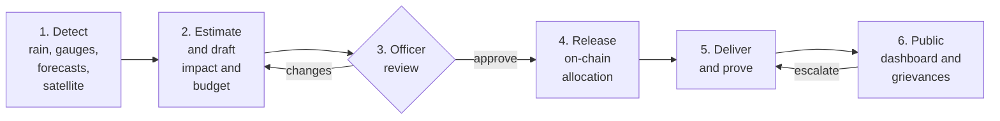
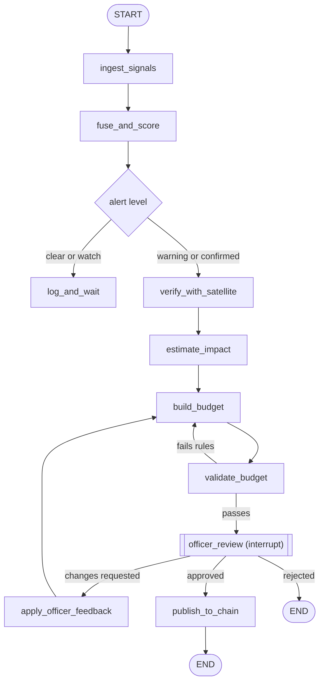
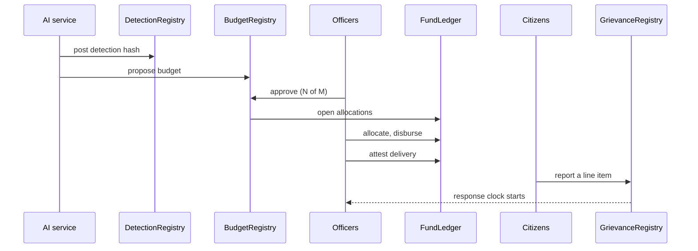

# Rahat: AI Flood Intelligence and a Public Relief Ledger

**Detect the flood. Draft the budget. Let officers approve it. Track every rupee on-chain. Let citizens call out what never arrived.**

*Project spec, October 2026. Stack: Next.js (frontend and backend), LangGraph (AI workflow), Solidity on an EVM chain (web3).*

---

## 0. The idea on one page

Rahat is one pipeline with six stages and a human at every point where money or public trust is on the line.

| # | Stage | Who does it | What comes out |
|---|-------|-------------|----------------|
| 1 | **Detect** | AI workflow (LangGraph) | A flood alert for a place, with a confidence level, produced from rainfall, river gauges, hydrology forecasts and satellite imagery |
| 2 | **Estimate and draft** | AI workflow | Predicted flood extent and depth, people and assets exposed, expected damage, and a draft relief budget by department |
| 3 | **Review** | Government officers | Approve, reject, or request changes. The AI revises and asks again |
| 4 | **Release** | Officers sign, smart contracts record | Approved budget and per-department allocations recorded on a public chain |
| 5 | **Deliver and prove** | Departments | Each line item (food, shelter, medicine) gets delivery evidence attached |
| 6 | **Report** | Citizens | Public grievance dashboard: "money allocated, food never came" reports tied to the exact line item |

**Interpretation I made:** you wrote "officers on commission". I read that as a *review committee of authorised officers* (for example the District Magistrate, State Disaster Management Authority and Finance). If you meant something else, only Section 6 changes.

**Three rules the whole design follows**

1. **The AI proposes. Humans decide. The AI never holds a key that can move money.**
2. **Numbers come from deterministic code, not from the language model.** The LLM explains, translates and reconciles feedback. A calculator tool does the arithmetic.
3. **Use the blockchain only where public, tamper-proof records matter**: detection timestamps, approvals, allocations, delivery proofs, grievance timestamps. Everything else stays in an ordinary database.

---

## 1. Problem and vision

- **Slow:** disaster budgets are usually assembled by hand after the water has already arrived.
- **Opaque:** citizens cannot easily see what was allocated, to whom, or whether it was delivered.
- **Unaccountable:** when relief fails to arrive, there is no public, timestamped record of the complaint or of the official response.

Rahat closes that loop end to end: *detect → budget → approve → release → deliver → report → escalate*.

---

## 2. End-to-end flow



---

## 3. Stage 1: the flood detection algorithm

### 3.1 What "before the news" can honestly mean

This is the claim judges and officers will test, so frame it precisely.

| Flood type | Can Rahat beat the news? | Why |
|------------|--------------------------|-----|
| **Riverine (slow rise)**, such as Brahmaputra, Mahanadi, Ganga basins | **Yes, often by many hours to days** | Rainfall upstream and rising gauges give a forecastable lead time |
| **Coastal and cyclone surge** | **Yes**, driven by cyclone tracks and tide forecasts | Forecast products exist well ahead |
| **Flash floods, cloudbursts, urban flooding** | **Only minutes to a few hours**, via rainfall nowcasting | The event develops faster than any satellite revisit |
| **Confirming that a place is actually under water** | **Not instant** | Sentinel-1 radar revisits any given spot only every several days (roughly 6 to 12), so satellites *confirm*, they do not *alert* |

So the correct design is **forecast-first, satellite-confirm**. Detection comes from fusing fast signals. Satellite imagery then confirms and maps the real extent.

**Make the claim provable.** Measure lead time against the first media mention of each event. GDELT timestamps news coverage globally, so "Rahat flagged it N hours before the first news item" becomes a number rather than a boast. Also see 3.6.

### 3.2 Signals to fuse

| Signal | What it tells you | Typical latency | Notes (verify access and licence before relying on it) |
|--------|-------------------|-----------------|---------|
| **Rainfall estimates** (NASA GPM IMERG early run, IMD gridded data) | How much rain fell, 24/48/72 h accumulations | Hours | Compare accumulations to local exceedance percentiles |
| **Rainfall forecast** (numerical weather prediction, IMD or global models) | How much rain is coming | Updates a few times a day | Gives the lead time |
| **River gauges** (CWC, India-WRIS) | Stage versus warning and danger level, rate of rise | Hourly where telemetry exists | Check which stations expose machine-readable data. Some access may need an MoU with CWC |
| **Hydrological forecasts** (Copernicus GloFAS discharge probabilities; Google Flood Hub; CWC's C-FLOOD for Mahanadi, Godavari and Tapi) | Probability a river exceeds a 2-, 5- or 20-year flow | Daily | C-FLOOD publishes inundation forecasts up to two days ahead for those three basins. Public programmatic access is unconfirmed |
| **Soil moisture** (SMAP, ERA5-Land) | Whether ground can absorb more rain | Daily | Wet ground turns the same rain into more runoff |
| **Terrain** (DEM, HAND) | Which low-lying cells flood first | Static | Precomputed once |
| **Sentinel-1 SAR** | Water extent through cloud, day or night | Revisit every several days | Confirmation step |
| **Sentinel-2 optical** | Water extent when skies are clear | Days | Often cloud-blocked in monsoon |
| **Citizen reports and local-language news** | Early ground truth | Minutes | Weak signal, easy to spoof. Low weight, used only for corroboration |

### 3.3 Fusion and alert logic

Work on a grid of sub-basins or ~1 km cells across India. Every 30 minutes compute a probability of flooding in the next 6 to 72 hours.

```text
for each cell b, every 30 minutes:
    R = rainfall_score(b)   # percentile of 24/48/72h accumulation + forecast rain, vs local climatology
    H = hydro_score(b)      # max over upstream gauges of (stage - warning) / (danger - warning), clipped 0..1,
                            #   blended with GloFAS probability of exceeding the 5-year return flow
    S = soil_score(b)       # antecedent saturation 0..1
    T = terrain_score(b)    # low-lying / low HAND / flat => higher (static)
    C = crowd_score(b)      # corroborated citizen reports (small weight)

    P = sigmoid(w0 + wR*R + wH*H + wS*S + wT*T + wC*C)     # weights fitted on historical floods

alert state machine (with hysteresis so alerts do not flicker):
    P >= 0.35 for 2 consecutive cycles          -> WATCH
    P >= 0.60                                    -> WARNING   (triggers impact + budget stages)
    gauge >= danger level OR SAR/optical extent
        above minimum area                       -> CONFIRMED
    P < 0.25 for 6 consecutive cycles            -> CLEAR
```

- **Start simple.** A logistic regression is explainable ("this alert fired because upstream gauge X is 0.8 of the way to danger level and 72 h rain is above the 97th percentile"). Move to gradient boosting (LightGBM) once you have enough labelled events.
- **The thresholds above are starting values to tune on backtests, not tested constants.**
- **Output of this stage:** an `Alert` object with cell or polygon, level, probability, contributing signals, expected peak time and a data fingerprint (see 3.6).

### 3.4 Satellite confirmation pipeline

1. Pull Sentinel-1 GRD scenes (VV and VH polarisation) for the affected area. Apply orbit correction, thermal-noise removal, speckle filtering and terrain correction, then convert to decibels.
2. Build a **dry baseline**: the median of earlier scenes from the same orbit.
3. Mark flood candidates where backscatter is low (water is dark to radar) **and** has dropped a few dB compared with the baseline. Use a per-tile Otsu threshold. As a starting point, VV below about -18 dB with a drop of at least 3 dB.
4. **Mask false positives:** permanent water (JRC Global Surface Water), steep slopes and high ground (HAND), radar shadow and layover.
5. **Optional upgrade:** a U-Net segmentation model trained on the public Sen1Floods11 dataset for more robust masks.
6. **Depth estimation:** intersect the water mask with a DEM using a floodwater depth method (FwDET-style). Depth matters more than area for damage.
7. When skies clear, cross-check with Sentinel-2 water indices.

Processing at scale is easiest in Google Earth Engine or with Sentinel Hub APIs. Check the licensing terms for government or commercial use before committing.

### 3.5 Validation: how you prove it works

- **Backtest on past events**, such as Assam's annual Brahmaputra floods, Kerala 2018, Chennai 2015 and 2023, Himachal 2023. Replay the data as it existed at the time.
- **Metrics:** detection rate, false alarm rate, lead time versus first news mention (GDELT), and extent accuracy against official or satellite-derived flood maps (intersection over union).
- **Publish the confusion matrix, including the misses.** Honest numbers beat impressive-sounding ones.
- **Ground truth sources:** Dartmouth Flood Observatory event archive, Global Flood Database, official state post-flood assessments.

### 3.6 A tamper-proof detection timestamp (the web3 hook for Stage 1)

When an alert reaches WARNING, the system writes a **hash of the alert plus its input data** to a `DetectionRegistry` contract. The chain's block timestamp then proves *when* Rahat knew, without exposing raw data. Later, "we flagged this 9 hours before the first news report" is independently verifiable by anyone. This costs a few cents and is a strong demo moment.

---

## 4. Stage 2: impact estimation and budget drafting

### 4.1 From flood map to impact

Inputs, all intersected with the predicted or confirmed flood polygon and depth:

| Layer | Example sources | Used for |
|-------|-----------------|----------|
| Population grid | WorldPop, GHSL (Census 2011 and projections as cross-check) | People exposed and displaced |
| Buildings | Open building footprints, OSM, GHSL | Housing damage |
| Cropland | ESA WorldCover, ISRO Bhuvan land cover | Crop loss |
| Roads and bridges | OSM | Repair and access cost |
| Facilities | Hospitals, schools, relief-centre candidates (OSM, state lists) | Health and shelter needs |
| Livestock | Livestock census (district level) | Fodder and loss support |
| Vulnerability | Housing type, poverty indices | Adjusts the expected damage |

**Damage model:** use published depth-damage curves, for example the JRC global flood depth-damage functions, to turn flood depth into a damage fraction per asset class. Keep the curves in configuration so analysts can swap in India-specific ones.

**Spread prediction:** for the "how far can it go" question, take the hydrological forecast (peak discharge and timing) and the 2-D inundation outputs where available (such as C-FLOOD for its three basins). Elsewhere, extend the confirmed extent with a simple terrain-based spreading model, and report it as a range.

### 4.2 Budget builder: mapped to official relief norms

India's State Disaster Response Fund (SDRF) and National Disaster Response Fund (NDRF) pay for relief against a published **items and norms** schedule issued by the Ministry of Home Affairs. Building the budget **on those line items** makes it something officers can actually approve.

- **Do not hardcode any rate.** Load the current norms table from a versioned config file (`sdrf_norms.yaml`) that officers or analysts update when the notification changes. Show the norm version on every budget.
- **Each line item = a formula, a quantity from the impact model, and a rate from the norms table.**

| Budget line (examples) | Quantity comes from | Rate comes from |
|------------------------|---------------------|-----------------|
| Relief camps, food and water | Displaced people × expected days | Norms table |
| Clothing and utensils | Displaced households | Norms table |
| Ex-gratia for deaths | Mortality estimate (wide range, see 4.4) | Norms table |
| Medical teams and supplies | Exposed population, outbreak risk | Norms table |
| Housing repair and reconstruction | Buildings by damage class | Norms table |
| Crop input subsidy | Cropland flooded by depth class | Norms table |
| Livestock and fodder | Livestock in flooded area | Norms table |
| Repair of roads, bridges, embankments | Network length affected | Unit-cost schedule (PWD) |
| Boats, rescue and logistics | Cells that are cut off | Unit-cost schedule |

**Worked illustration (placeholder numbers, not official rates):** if the model says 40,000 people will be displaced for 7 days and the norms table gives a daily rate `r_food` per person, the line is `40,000 × 7 × r_food`. The AI produces the 40,000 and the 7 with their uncertainty ranges. The calculator tool multiplies them by the rate from the file.

### 4.3 Allocation to departments

The total is split by the department that owns each line: Revenue and Disaster Management, Health, Food and Civil Supplies, Public Works, Water Resources, Agriculture, Animal Husbandry, Rural Development, Power. The mapping lives in config and is shown to officers.

### 4.4 Guardrails against a confident wrong budget

- **Ranges, not single numbers.** Report P10, P50 and P90 for people affected and for the total. Officers choose which percentile to fund (for example P75 for emergency release, with the rest held until confirmation).
- **Deterministic validator node.** Re-computes every line, checks totals, checks against norm limits, flags outliers versus past events. A budget that fails validation never reaches an officer.
- **Explanations attached to every line:** inputs used, assumptions, data timestamps and a confidence note.
- **Never invent a fact.** If a layer is missing for a region (no livestock data, say) the line is marked "insufficient data" instead of guessed.

---

## 5. The LangGraph design

### 5.1 State

One typed state object flows through the graph and is checkpointed at every step:

```text
RahatState:
  event_id, region_polygon
  signals          # latest rainfall, gauge, forecast, soil readings with timestamps
  alert            # level, probability, contributing signals, data_hash
  satellite        # flood mask, area, depth raster reference
  impact           # people, buildings, crops, roads (P10 / P50 / P90)
  budget           # version, line items, totals, norm_version, explanations
  validation       # pass / fail and the list of failed rules
  review           # status, officer comments, requested changes
  chain            # tx hashes, budget id on-chain
```

### 5.2 Graph



### 5.3 How the approval pause works

LangGraph supports this directly: a node calls `interrupt(payload)`, the checkpointer saves the exact graph state, and the run stays paused for hours or days. When an officer decides, the web app resumes the run with `Command(resume=...)` using the same `thread_id`.

Practical rules from the LangGraph documentation that matter here:

- A **durable checkpointer is required** (use the Postgres-backed one in production, not the in-memory one).
- On resume the interrupted node **restarts from its beginning**, so anything before `interrupt()` must be safe to repeat.
- The interrupt payload must be **JSON-serialisable**.
- Do not wrap `interrupt()` in a bare try/except.

### 5.4 Which nodes use the LLM and which do not

| Node | LLM? | Why |
|------|------|-----|
| ingest_signals, fuse_and_score, verify_with_satellite | No | Deterministic data and geospatial code |
| estimate_impact | No (models plus tools) | Raster maths and fitted models |
| build_budget | **Tool-calling agent** | LLM decides which tools to call and writes the explanations. A calculator tool does all arithmetic |
| validate_budget | No | Rule-based checks |
| apply_officer_feedback | **Yes** | Converts free-text officer comments into parameter changes ("raise relief days from 7 to 10", "exclude block X") |
| Grievance triage (separate small graph) | **Yes** | Classify, translate, de-duplicate, link to a line item |

### 5.5 The safety boundary

`publish_to_chain` only *submits the approved package to the officers' signing flow*. The on-chain approval itself needs the officers' own signatures. The AI service holds exactly one low-privilege key that can post detection hashes and budget proposals. That key **cannot approve, allocate or release anything**.

---

## 6. Stage 3: officer review

- **Roles:** Reviewer (read and comment), Approver (counts toward the threshold), Finance Officer (allocation and disbursement entries), Auditor (read everything, verify grievances).
- **Threshold approval:** a budget needs *N of M* distinct approvers (for example 2 of 3: District Magistrate, SDMA representative, Treasury or Finance officer).
- **Review screen:** map of predicted extent, line items with formulas and ranges, the AI's explanation per line, a diff against the previous version, and a comment box per line.
- **Request changes:** an officer comments on a line ("camp days should be 10, block B is cut off"). The graph resumes at `apply_officer_feedback`, produces **v2** with a visible diff, and returns it for review. Every version is kept.
- **Identity:** wallet-based sign-in (SIWE) tied to an officer registry maintained by the department. Production deployments would add a department-issued credential or digital signature certificate on top.
- **Audit trail:** every view, comment, version and approval is logged. Approvals and versions are also anchored on-chain.

---

## 7. Stage 4: the web3 layer

### 7.1 What is actually on-chain

| Contract | Purpose | Written by |
|----------|---------|------------|
| `DetectionRegistry` | Timestamped hash of each alert and its input data | AI service key (post only) |
| `BudgetRegistry` | Budget versions (document hash plus totals), officer approvals, final approval | AI posts proposals. Officers approve |
| `FundLedger` | Allocation per event, department, district and line item. Disbursement records. Delivery attestations | Finance officers |
| `EvidenceRegistry` | Hashes of delivery proofs (photos, receipts, beneficiary lists) | Department officers |
| `GrievanceRegistry` | Timestamp, hash and status of each citizen report, officer response times, escalation | Citizens submit hashes. Officers and auditors update status |

**Large documents and photos stay off-chain** (IPFS plus your own storage). Only their hashes go on-chain, which proves they were not altered afterwards.

### 7.2 Sequence



### 7.3 Be clear about what is real money

**A public blockchain does not move rupees by itself.** There are three honest stages:

1. **MVP and hackathon:** the chain is the **public ledger of record**. Contracts keep non-transferable accounting entries in paise (not a tradeable token). Real money still moves through treasury channels. Each disbursement entry stores a hash of the treasury or bank transaction reference.
2. **Pilot:** integrate with the state's treasury or public financial management systems so a ledger entry is created from the real payment event (integration details must be confirmed with the department).
3. **Later:** explore programmable payments through India's central bank digital currency pilots, subject to regulation.

**Do not issue a tradeable token.** It adds regulatory, tax and security problems and nothing the use case needs.

### 7.4 Which chain

| Option | Public verifiability | Cost per transaction | Tooling | Fit |
|--------|---------------------|----------------------|---------|-----|
| **Polygon PoS** (Amoy testnet while building) | High | Very low | Full EVM tooling, large Indian developer community | **Recommended default** |
| Base or Arbitrum One | High | Low | Full EVM tooling | Good alternative |
| Ethereum mainnet | Highest | High | Best | Overkill and costly for this use |
| Permissioned network (Hyperledger Besu) | Only to members, unless anchored publicly | Near zero | EVM compatible | Good for data-sovereignty. Needs periodic state anchoring to a public chain to keep public verifiability |
| Dedicated app-chain (a rollup framework) | High | Low | More operational work | Later stage, not for a hackathon |

**Recommendation:** build and demo on **Polygon Amoy**, deploy the pilot on **Polygon PoS**, and keep the contracts chain-agnostic EVM so switching is a configuration change. If a state insists on data sovereignty, run a permissioned Besu network and anchor its state root to Polygon on a schedule. Chain status and fees change, so re-check before a real deployment.

### 7.5 Contract tooling

- **Solidity 0.8.x** with **Foundry** for tests, fuzzing and deployment scripts.
- **OpenZeppelin** `AccessControl` for roles, `Pausable` for an emergency stop.
- **Threshold approval:** a simple N-of-M check inside `BudgetRegistry` for the hackathon. Move to a **Safe** multisig for the pilot.
- **Corrections are new entries, never edits.** A wrong allocation is fixed with a visible reversing entry. That is what makes the record trustworthy.
- **Indexing:** **Ponder** (TypeScript, fits the Next.js stack) or **The Graph** to turn contract events into queryable tables for the dashboard.
- **Client:** **wagmi + viem** with RainbowKit for officer wallets. Citizens do **not** need wallets (see 8.3).
- **Key management:** the AI service key lives in a cloud KMS or vault, with rate limits and a role that can only post hashes and proposals.

---

## 8. Stages 5 and 6: public dashboard and grievance system

### 8.1 Public pages

- **Live map:** current alerts by level, with lead-time proof for past events.
- **Event page:** a timeline of Detected → Budget proposed → Revisions → Approved → Released → Delivered, with on-chain links for each step.
- **Money flow:** a Sankey diagram from event to department to district to line item.
- **Department scoreboard:** allocated versus disbursed versus *delivery proven*. The third number is the one that matters.
- **Grievance feed:** reports by area, category and status.

### 8.2 Grievance flow

1. A citizen opens a line item ("Food packets, Block B, allocated, delivery not attested") and files a report: category, description, photos, location.
2. AI triage: detect language and translate, remove duplicates, classify, and attach to the right line item.
3. A hash and timestamp go to `GrievanceRegistry`. The **response clock starts**.
4. The responsible officer must respond with evidence by a deadline. A missed deadline **escalates automatically** to the next level (block → district → state).
5. An auditor marks the report **Corroborated**, **Verified** or **Dismissed**, with reasons visible to all.

**Categories:** funds not received, relief not delivered, spoiled or short-quantity supplies, wrongful exclusion of a household, officer absent or negligent, bribe demanded.

### 8.3 Making it hard to abuse, and safe to use

| Risk | Mitigation |
|------|------------|
| Spam and fake reports | Phone OTP, rate limits, geofence to the affected area, AI duplicate detection |
| Defamation of individuals | Reports attach to **line items and offices**, not named people, until an auditor verifies them |
| Reporter retaliation | **No identity on-chain.** Store contact details encrypted off-chain with strict access, and offer anonymous submission. An optional later upgrade is zero-knowledge group signalling (for example Semaphore) |
| Low connectivity | WhatsApp, SMS and voice-note intake feeding the same triage graph |
| Language | Hindi, English and regional languages via LLM translation, with the original text preserved |
| Brigading | A report becomes "Corroborated" only after independent confirmations from different users or an auditor |
| Evidence tampering | Photo hashes recorded at upload. EXIF and location checked, but treated as a weak signal because both are easy to fake |

Personal data handling should follow India's Digital Personal Data Protection Act, 2023. Have counsel review the final design.

---

## 9. Recommended tech stack

| Layer | Choice | Why |
|-------|--------|-----|
| **Frontend and backend** | **Next.js** (App Router, TypeScript), Route Handlers and Server Actions | As requested. One codebase for the dashboard, officer console and APIs |
| UI | Tailwind CSS, shadcn/ui, next-intl for languages | Fast, accessible, multilingual |
| Maps | **MapLibre GL JS** with deck.gl for flood layers | Open source, no per-view map fees |
| Charts | Recharts or Nivo (Sankey) | Money-flow view |
| Database | **PostgreSQL + PostGIS** (Neon or Supabase) with Drizzle or Prisma | Geospatial queries and relational audit data |
| Cache and limits | Redis | Rate limiting, caching |
| Files | S3-compatible storage plus **IPFS** (Pinata) for evidence | Off-chain storage, on-chain hashes |
| Auth | Auth.js with **SIWE** for officers, phone OTP for citizens | Wallet identity for signers, no wallet burden on the public |
| **AI workflow** | **LangGraph (Python)** with the Postgres checkpointer, served by **FastAPI** | See note below |
| Geospatial and ML | rasterio, xarray, geopandas, earthengine-api or Sentinel Hub, scikit-learn, LightGBM, PyTorch | The mature geo and ML ecosystem is Python |
| Scheduling | Celery beat, Prefect, or a cloud scheduler | The 30-minute detection loop |
| LLM | Any strong model API with structured (JSON-schema) output | Explanations, feedback parsing, triage |
| Tracing | LangSmith | Inspect every agent step during demos and audits |
| **Web3** | **Solidity + Foundry + OpenZeppelin on Polygon**, **Ponder** indexer, **wagmi + viem + RainbowKit** | Section 7 |
| Hosting | Vercel for Next.js, Railway or Fly.io for the AI service, managed Postgres | Quick to stand up |
| Monitoring | Sentry | Errors on both services |

**Why the AI part is a separate service and not inside Next.js:** serverless functions have execution time limits, and the geospatial and satellite libraries are Python. Next.js talks to the AI service over HTTP and receives approval-needed events through a webhook or polling. LangGraph also has a JavaScript version, but you would lose most of the geo tooling.

---

## 10. Data model (essentials)

```text
events(id, region, level, detected_at, detection_hash, tx_hash)
signals(id, event_id, source, value, observed_at)
budgets(id, event_id, version, norm_version, total_p50, total_p90, doc_cid, status)
budget_lines(id, budget_id, department_id, item_code, quantity, rate, amount, explanation)
reviews(id, budget_id, officer_id, decision, comment, signed_at, tx_hash)
allocations(id, budget_line_id, department_id, district_id, amount, tx_hash)
disbursements(id, allocation_id, amount, treasury_ref_hash, tx_hash)
delivery_proofs(id, allocation_id, evidence_cid, attested_by, tx_hash)
grievances(id, line_item_id, category, text_original, text_translated, status, evidence_hash, tx_hash, created_at)
officer_responses(id, grievance_id, officer_id, text, evidence_cid, responded_at)
```

---

## 11. Security, privacy and legal notes

- **Not an official warning system.** Warnings to the public are issued by the authorities (IMD, CWC, NDMA and state authorities). Rahat sends alerts to *officers*. Do not broadcast alerts to the public from this app, because false alarms cause real harm.
- **Irreversible mistakes:** because on-chain data cannot be edited, the validation step before publishing is strict, and corrections are recorded as new entries.
- **Key custody:** officer keys are theirs. The AI service key is minimal, vault-held and rotated.
- **Data licences:** confirm terms for every data source, especially for government or commercial deployment.
- **Procurement and adoption:** a real deployment needs a sponsoring department, a data-sharing agreement and a pilot district. For a hackathon, simulate this and say so openly.

---

## 12. Roadmap

### Hackathon MVP (36 to 48 hours)

**Real:** one river basin, two or three live or recorded data feeds, a Sentinel-1 flood mask for one historical event, the LangGraph budget agent with a norms config file, the officer approve-or-revise loop, contracts on a testnet, the public dashboard, and the grievance form with line-item linking.

**Simulated (say so on stage):** the live trigger (a "replay the 2024 flood" button), officer identities, and treasury payments.

| Block | Goal | Done when |
|-------|------|-----------|
| 0 to 6 h | Repo, schema, contracts skeleton, one data feed | Alert object produced from real data |
| 6 to 16 h | Fusion score, impact calculation, budget builder with norms config | Budget with ranges generated for one region |
| 16 to 24 h | LangGraph interrupt and resume, officer review screen | Officer requests a change and gets v2 |
| 24 to 32 h | Contracts deployed, approval and allocation on-chain, indexer | Dashboard shows live on-chain flow |
| 32 to 40 h | Grievance flow, escalation timer, line-item linking | A report appears against a line item |
| 40 to 48 h | Backtest numbers, polish, backup video | Lead-time figure on a slide |

**Cut order if time runs out:** multilingual intake, then Sankey, then satellite U-Net (use a simple threshold), then the permission screens. Never cut the detect → budget → approve → on-chain loop.

### 30 days
Backtest across three or more basins. Replace thresholds with a fitted model. Add WhatsApp intake. Security review of the contracts.

### Pilot
One district, one department sponsor, treasury integration, external audit, and published accuracy report.

---

## 13. Risks and honest limits

| Risk | What to do |
|------|------------|
| "Before the news" claim does not hold for flash floods | Say so. Show lead time per flood type from backtests |
| Missing or restricted data feeds (for example gauge data) | Start with open sources, pursue an MoU for the rest |
| AI budget looks precise but is wrong | Ranges, validator, norms file, officer review |
| Satellite revisit too slow | Treat satellites as confirmation only |
| Fake grievances or political misuse | Line-item linking, corroboration, auditor verification, no named individuals before verification |
| Ledger shows allocation but not real payment | Be explicit about the three-stage money path in Section 7.3 |
| Scope too large for a hackathon | Build one flawless vertical slice rather than six thin ones |

---

## 14. Will it stand out?

Better than the earlier version, yes. Many teams build "transparent donations" or "on-chain escrow". Very few connect **detection to budgeting to approval to delivery to citizen accountability** with a provable timestamp at the start and a public complaint trail at the end. The tamper-proof detection timestamp and the line-item-linked grievance system are the two memorable ideas.

What will decide it:

- **A real lead-time number from a backtest.** A measured "flagged 14 hours before the first news" (if the data supports it) beats any amount of architecture.
- **A flawless demo of one vertical slice.**
- **Honesty about limits.** Judges and officers both trust a team that says what is simulated.
- **The framing:** an assistant that prepares the budget so officers decide faster and the public can check the result, not a system that replaces officials.

---

## 15. References

- [CWC, C-DAC and NRSC launch C-FLOOD: two-day inundation forecasts for the Mahanadi, Godavari and Tapi basins (Deccan Herald)](https://www.deccanherald.com/amp/story/india%2Fcentre-unveils-c-flood-a-unified-flood-forecasting-system-3612789)
- [Google: expanding ML-based flood forecasting, Flood Hub (Google blog)](https://blog.google/innovation-and-ai/products/expanding-our-ml-based-flood-forecasting/)
- [LangGraph human-in-the-loop: interrupt and Command(resume) (LangChain docs)](https://docs.langchain.com/oss/python/langgraph/human-in-the-loop)
- [LangGraph persistence and checkpointers (LangChain docs)](https://docs.langchain.com/oss/python/langgraph/persistence)
- [Disaster finance in India: SDRF, NDRF and the 16th Finance Commission's risk index (NextIAS analysis)](https://www.nextias.com/ca/editorial-analysis/01-04-2026/disaster-finance-india)

*Data products named in this document (GPM IMERG, GloFAS, Sentinel-1 and 2, WorldPop, GHSL, JRC depth-damage functions, Sen1Floods11, GDELT, Dartmouth Flood Observatory) were named from general knowledge and not individually re-verified for access terms. Check each before depending on it.*
