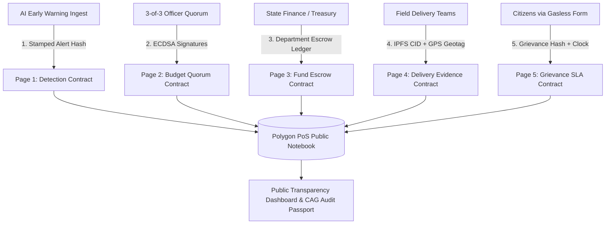

# Blockchain Master Architecture: The Public Notebook

> **Why Blockchain for Flood Relief?**
> In traditional disaster management, government databases are centralized—records can be quietly modified, retroactively approved, or deleted after inquiries start. 
> 
> The **Public Notebook (Polygon PoS)** provides two mathematically indisputable guarantees:
> 1. **Proof of When**: *"FlashRelief flagged this flood at 03:42 AM"* cannot be backdated or faked after the news hits.
> 2. **Proof of What**: Once an approved budget, department allocation, or citizen grievance is stamped, it cannot be edited or erased without breaking the cryptographic chain.

---

## 1. Core Principles & Non-Goals

```text
┌────────────────────────────────────────────────────────────────────────┐
│                        WHAT THE NOTEBOOK DOES                          │
├────────────────────────────────────────────────────────────────────────┤
│ ✔ Stamped Hashes Only (Fingerprints of files, photos, data & coords)   │
│ ✔ Zero Fiat/Crypto Transfers on-chain (Rupees move via RBI/PFMS/Banks) │
│ ✔ Zero Volatile Tokens or Coins (No ICO, no speculation, zero tokens)  │
│ ✔ Zero Wallet Friction for Citizens (Gasless meta-transaction relayers)│
│ ✔ 100% Publicly Auditable by any citizen, journalist, or CAG auditor   │
└────────────────────────────────────────────────────────────────────────┘
```

- **Not storing raw media on-chain**: Photos, videos, and beneficiary identity documents never touch the blockchain. Only their cryptographic **SHA-256 fingerprint** and **IPFS CID** are stored. If a single pixel is altered, the fingerprint fails verification.
- **No speculative crypto**: FlashRelief uses Polygon PoS purely as a **tamper-proof notarization engine** ($<\$0.005$ per entry, 2-second block finality).

---

## 2. The 5 Smart Contract "Pages"



---

### Page 1: Detection Page (`DetectionRegistry.sol`)
*Automated alert notarization. Proves lead-time hours before mainstream news media.*

- **Who can write**: Automated Detection Agent (whitelisted sensor oracle). Cannot move funds or approve budgets.
- **What gets written**:
  ```solidity
  struct DetectionRecord {
      bytes32 eventId;          // e.g. keccak256("fl-2026-brahmaputra")
      uint8 alertLevel;         // 0: CLEAR, 1: WATCH, 2: WARNING, 3: CONFIRMED
      uint16 probabilityBasis;  // e.g. 9400 for 94.00%
      uint32 leadTimeSeconds;   // e.g. 41040 (11.4 hours)
      bytes32 telemetryHash;    // keccak256(GPM_rain + CWC_gauge + GloFAS_discharge)
      bytes32 satelliteMaskCid; // IPFS CID of Sentinel-1 SAR inundation GeoTIFF
      uint64 timestamp;         // Block timestamp
  }
  ```
- **Public Audit Proof**: Anyone can verify: *"This flood was flagged 11.4 hours before the first news report."*

---

### Page 2: Budget Quorum Page (`BudgetQuorum.sol`)
*Multi-signature consensus over the deterministic MHA SDRF budget draft.*

- **Who can write**: 3-of-3 designated government officer wallets using private keys:
  1. **Relief Commissioner / DM** (`IAS` cadre)
  2. **Chief Technical Advisor** (`NDMA` cadre)
  3. **Joint Secretary (Finance)** (`IDAS` cadre)
- **What gets written**:
  ```solidity
  struct BudgetApproval {
      bytes32 eventId;
      uint256 totalPaise;       // Precise integer amount (₹7.35 Cr = 7350000000 paise)
      bytes32 lineItemsRoot;    // Merkle Root of all individual MHA SDRF line items
      address[3] signers;       // Public keys of the 3 approving officers
      bytes[3] signatures;      // ECDSA cryptographic signatures
      uint64 finalizedAt;       // Immutable approval timestamp
  }
  ```
- **Rule**: If even one officer rejects or requests an amendment, the state transition halts and diff comments are committed to the public ledger.

---

### Page 3: Fund Escrow Page (`FundEscrowLedger.sol`)
*Departmental money allocation audit. Tracks commitments vs actual releases.*

- **Who can write**: State Treasury & Disaster Management Finance Officers.
- **What gets written**:
  ```solidity
  struct DepartmentVault {
      bytes32 departmentId;     // e.g. "food_cs", "pwd_bridges", "health_fws"
      uint256 allocatedPaise;   // Total amount assigned by budget quorum
      uint256 disbursedPaise;   // Amount released to district treasuries
      uint256 provenPaise;      // Amount mathematically proven by Stage 05 receipts
      uint8 state;              // 0: PRE_ALLOCATED, 1: LOCKED, 2: RELEASING, 3: SETTLED
  }
  ```
- **Rule**: Prevents bureaucratic fund diversion. Department budgets are locked to their approved SDRF norm codes.

---

### Page 4: Evidence Page (`DeliveryEvidence.sol`)
*The Third Number audit: Proving relief was actually delivered to human beneficiaries.*

- **Who can write**: Verified field relief contractors, civil defense volunteers, drone survey units.
- **What gets written**:
  ```solidity
  struct DeliveryProof {
      bytes32 lineItemId;       // SDRF norm code (e.g. "SDRF-03-SHELTER")
      string ipfsCid;           // Content ID of geo-tagged distribution photos & logs
      int32 latitudeE6;         // Latitude * 1,000,000 (e.g. 27.472800 -> 27472800)
      int32 longitudeE6;        // Longitude * 1,000,000 (e.g. 94.912000 -> 94912000)
      uint32 beneficiaryCount;  // Verified recipients
      uint64 timestamp;         // Delivery timestamp
  }
  ```
- **The Third Number Formula**:
  $$\text{Audit Leakage} = \text{Disbursed INR} - \text{Proven Delivered INR}$$

---

### Page 5: Grievance SLA Page (`GrievanceSLA.sol`)
*Public grievance ledger with an immutable 48-hour countdown clock.*

- **Who can write**: Citizens filing through an open SMS/WhatsApp/Web form (gasless meta-relayer).
- **Privacy Protection**: Citizen phone numbers and names are never stored on-chain. Only `keccak256(phone + salt)` is stored.
- **What gets written**:
  ```solidity
  struct GrievanceEntry {
      bytes32 trackingId;       // e.g. "GRV-2026-081"
      bytes32 citizenHash;      // Anonymous one-way hash
      uint8 category;           // 0: RATION, 1: SHELTER, 2: MEDICAL, 3: INFRA
      bytes32 issueHash;        // Hash of citizen statement & GPS location
      uint64 filedAt;           // Clock starts immediately
      uint64 slaDeadline;       // filedAt + 48 hours
      bool isResolved;
      uint64 resolvedAt;
  }
  ```
- **Statutory Enforcement**: Officers **cannot delete tickets or stop the clock**. If 48 hours lapse without resolution, the breach is automatically stamped as an escalation on the public explorer.

---

## 3. Permissions & Gasless Access Matrix

| Role | Allowed Actions | Key / Wallet Type | Gas Cost |
| :--- | :--- | :--- | :--- |
| **AI Detection Swarm** | Write alerts & proposed budgets | Automated Relayer Key (`SECP256k1`) | Sponsored |
| **Relief Officers (IAS/NDMA)** | Sign budget proposals, authorize escrow unlocks | Officer Hardware Key or Browser Wallet | Sponsored / Native |
| **Field Vendors / NGOs** | Upload IPFS delivery proofs & GPS coordinates | Operator Wallet | Sponsored |
| **Citizens** | Submit grievances & track SLA status | **Zero Wallet Needed** (Gasless Relay) | **Free ($0.00)** |
| **Public / Journalists** | Read, audit, verify SHA-256 hashes | Read-Only Public RPC | **Free ($0.00)** |

---

## 4. End-to-End Walkthrough Example

```text
[T-11.4h] 03:42 AM  AI Ingest detects Brahmaputra surge (GPM Rain: 184mm + CWC Stage: +0.44m).
                     → Writes alert hash to Detection Page (Tx: 0x7a29e1c4... · Block 19482850).
                     → Timestamp is permanently locked before morning news broadcasts.

[T-09.0h] 06:10 AM  Deterministic SDRF Engine calculates ₹7.35 Crores budget.
                     → District Magistrate (IAS), Technical Advisor (NDMA), and Finance Sec (IDAS)
                       sign with cryptographic keys on Budget Page (Quorum: 3-of-3).

[T-08.0h] 07:15 AM  Finance Officer releases initial tranche on Fund Page.
                     → Food Dept: ₹2.68 Cr · Revenue Dept: ₹2.10 Cr · Health Dept: ₹0.72 Cr.

[T+06.0h] 09:30 PM  Assam Civil Supplies distributes 4,200 ration kits at Majuli relief camps.
                     → Uploads geo-tagged photos to IPFS (bafybeicdx4a...) & registers proof
                       on Evidence Page. Proven delivery moves to ₹3.65 Crores.

[T+12.0h] 03:30 AM  Citizen in Jengraimukh reports infant formula missing at Camp #4.
                     → Grievance Page stamps ticket (GRV-2026-081) and starts 48-hour SLA clock.
                     → Officer resolves issue in 18 hours; resolution timestamp stamped permanently.
```

---

## 5. Implementation Stack & Integration

- **Target Network**: Polygon PoS (Amoy Testnet for staging / Polygon Mainnet for production).
- **Smart Contract Language**: Solidity `0.8.24` with OpenZeppelin `AccessControl` and `ECDSA`.
- **Client Integration**: `viem` / `@wagmi/core` for low-footprint RPC reads and contract invocations.
- **Relayer API Route**: [`app/api/blockchain/relay/route.ts`](file:///Users/utsavsingh/code/flashrelief/app/api/blockchain/relay/route.ts) to sponsor gas for citizens and automated AI alerts.
- **Contract Source Files**: Located in `contracts/` or `lib/blockchain/`.

### Current implementation status

The five Solidity page contracts are present in `contracts/` and the application exposes
the corresponding UI and API surfaces. The current relayer route computes payload
fingerprints and returns demo receipts; it does not yet submit transactions through a
Polygon RPC, wallet, ERC-2771 forwarder, or contract ABI. Contract deployment,
transaction signing, live receipt verification, and chain indexing remain production
integration work.
