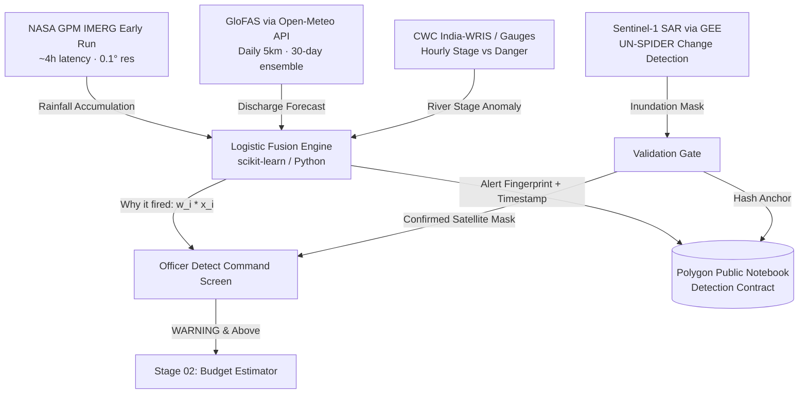
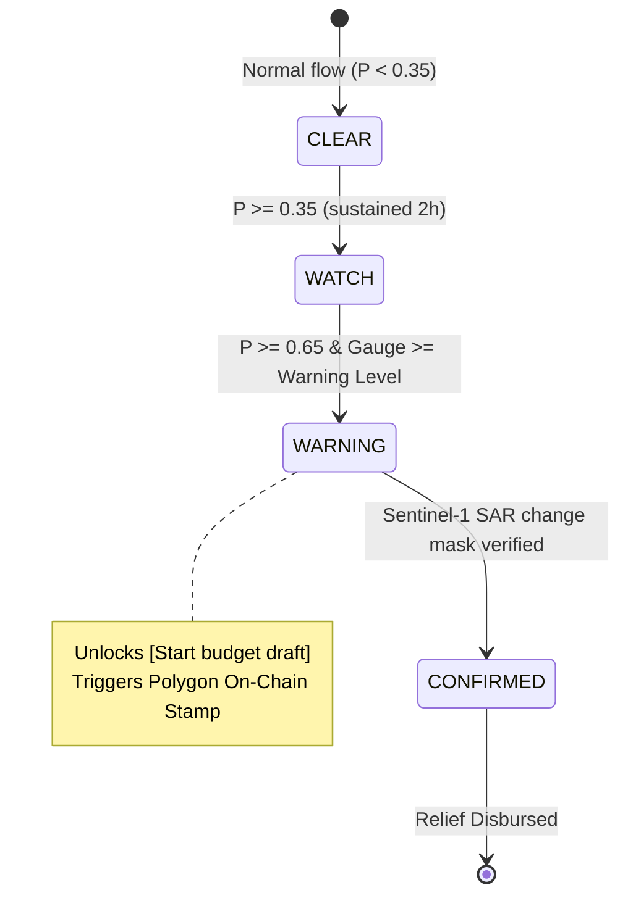

# Stage 01: Detect — Master Architecture & Implementation Plan

> [!IMPORTANT]
> **Core Civic Principle**: FlashRelief Detect is an **officer-facing decision support screen**, not a public panic siren. Alerts are held until validated by deterministic hydrological thresholds and satellite SAR confirmation. Every alert is timestamped on the **Polygon Public Notebook** before news breaks.

---

## 1. System Architecture & Multi-Feed Hydrological Pipeline



### The 4 Sensor Feeds & Specification

| Feed | Source & Resolution | Latency / Frequency | Role in Fusion Model |
| :--- | :--- | :--- | :--- |
| **Rainfall** | **NASA GPM IMERG Early Run** (0.1° / ~10 km, Earthdata / AWS Open Data) | ~4 hours latency | Measures 24h, 48h, and 72h upstream catchment cloudburst intensity ($x_1$). |
| **Discharge Forecast** | **GloFAS via Open-Meteo Flood API** (5 km grid, daily, 30-day forecast) | Daily runs + ensemble spread | Predicts peak discharge arrival time and volume 3–7 days out ($x_2$). |
| **River Gauges** | **CWC India-WRIS** (Recorded replay for demo; HydroSwift for telemetry) | Hourly water level (m) | Compares current stage to Warning Level ($WL$) and Danger Level ($DL$) ($x_3$). |
| **Satellite Check** | **Sentinel-1 SAR (Google Earth Engine)** (UN-SPIDER change detection) | Orbit pass (~24–48h) | Penetrates clouds at night; proves ground submergence to escalate to `CONFIRMED`. |

---

## 2. Explainable Logistic Fusion Model & "Why It Fired" Decomposition

Rather than an unexplainable black box, the detection probability $P(\text{flood})$ is computed using a calibrated logistic model:

$$z = w_0 + w_{\text{rain}} \cdot x_{\text{rain}} + w_{\text{gauge}} \cdot x_{\text{gauge}} + w_{\text{glofas}} \cdot x_{\text{glofas}} + w_{\text{terrain}} \cdot x_{\text{terrain}} + w_{\text{soil}} \cdot x_{\text{soil}}$$

$$P(\text{flood}) = \frac{1}{1 + e^{-z}}$$

### Feature Attribution Breakdown ("Why It Fired" Bars)
Every alert card displays linear feature contribution bars:
- **Rain Contribution**: $w_{\text{rain}} \cdot x_{\text{rain}}$ (e.g., $+0.32$ — Heavy 72h cloudburst upstream).
- **River Stage Contribution**: $w_{\text{gauge}} \cdot x_{\text{gauge}}$ (e.g., $+0.26$ — Gauge at $+0.44\text{m}$ above Warning Level).
- **GloFAS Forecast**: $w_{\text{glofas}} \cdot x_{\text{glofas}}$ (e.g., $+0.18$ — 90th percentile discharge exceeds 10-year return period).
- **Terrain & Soil**: $w_{\text{soil}} \cdot x_{\text{soil}}$ (e.g., $+0.12$ — Saturated Brahmaputra floodplain).
- **Ground Citizen Signals**: $+0.06$ — Telemetry verification.

---

## 3. The 4 Distinct Alert States & Hysteresis Rule



| Alert Level | Color & Token | Trigger Condition | Permitted Officer Actions |
| :--- | :--- | :--- | :--- |
| **`CLEAR`** | Mint / Green (`#10b981`) | $P < 0.35$, gauges below Warning Level | Normal monitoring. |
| **`WATCH`** | Cyan / Blue (`#00e5ff`) | $0.35 \le P < 0.65$, GloFAS forecast rising | Pre-position NDRF boat reconnaissance. |
| **`WARNING`** | Amber / Yellow (`#f4c969`) | $P \ge 0.65$, CWC Gauge $>$ Warning Level | **Unlocks `[Start budget draft]`** to Stage 02; On-chain hash stamped. |
| **`CONFIRMED`** | Coral / Red (`#ff785f`) | Sentinel-1 SAR flood mask verified $(> 10\text{ km}^2)$ | Full multi-sig quorum dispatch and smart escrow release. |

> [!TIP]
> **Anti-Flicker Hysteresis**: To prevent alert jitter, state upgrades require 2 consecutive sensor ingest windows above threshold; downgrades require 6 consecutive hours below threshold. The UI displays this transition timeline.

---

## 4. Officer Detect Screen Layout (`/detect`)

```text
┌────────────────────────────────────────────────────────────────────────────────────────┐
│ [Basin: Brahmaputra ▾]  Data Freshness: Rain ● (2h) · Gauges ● (15m) · GloFAS ● (6h)  │
│ [REPLAY MODE — ASSAM OCT 2026 ARCHIVE]  ⚠️ Decision support only — not a public warning │
├────────────────────────────────────────┬───────────────────────────────────────────────┤
│                                        │ ALERTS (Sorted by Severity)                   │
│ INTERACTIVE GIS MAP                    │ ┌───────────────────────────────────────────┐ │
│ - Cells shaded by inundation risk      │ │ ● WARNING: Majuli Sub-basin      P = 0.74 │ │
│ - CWC river gauges (interactive dots)  │ ├───────────────────────────────────────────┤ │
│ - Sentinel-1 SAR water mask overlay   │ │ ● WATCH: Dibrugarh Reach         P = 0.52 │ │
│ Layer toggles:                         │ ├───────────────────────────────────────────┤ │
│ [✔ Rain Heatmap] [✔ Gauges] [✔ SAR]    │ │ ○ CLEAR: Guwahati Metro          P = 0.18 │ │
│                                        │ └───────────────────────────────────────────┘ │
├────────────────────────────────────────┴───────────────────────────────────────────────┤
│ SELECTED ALERT INSPECTOR: Majuli Sub-basin (P = 0.74 · WARNING)                        │
│ Expected Peak: +11h 25m (27 Oct, 04:00 UTC) · Inundation Extent: 142.8 km²           │
│                                                                                        │
│ ┌─ Why It Fired (Logistic Decomposition) ────────────────────────────────────────────┐ │
│ │ Upstream Rain (GPM):  ████████████████░░░░  +0.32 (184mm in 72h)                    │ │
│ │ River Stage (CWC):    ████████████░░░░░░░░  +0.26 (+0.44m above Warning Level)       │ │
│ │ GloFAS Discharge:     ████████░░░░░░░░░░░░  +0.18 (Exceeds 10-yr return period)     │ │
│ │ Soil Saturation:      █████░░░░░░░░░░░░░░░  +0.12 (Antecedent index 88%)            │ │
│ └────────────────────────────────────────────────────────────────────────────────────┘ │
│                                                                                        │
│ ┌─ Tri-Chart Telemetry ──────────────┐ ┌─ Satellite SAR & Blockchain Stamp ──────────┐ │
│ │ 1. Gauge vs Warning/Danger Line    │ │ Sentinel-1 SAR: Pass completed at 06:14 UTC │ │
│ │ 2. 72-Hour Rain Accumulation       │ │ Water mask: 142.8 km² verified              │ │
│ │ 3. GloFAS 30-Day Discharge Curve   │ │ On-Chain Hash: 0x7a29e1c4... (Block 194828) │ │
│ └────────────────────────────────────┘ └─────────────────────────────────────────────┘ │
│                                                                                        │
│ [⚡ Start Budget Draft (Stage 02)]                [Mark False Alarm / Archive]          │
└────────────────────────────────────────────────────────────────────────────────────────┘
```

---

## 5. The "Public Notebook" (Polygon Blockchain Integration)

The notebook does not handle fiat or crypto tokens; it acts as an **immutable civic notary**:

| Contract / "Page" | What Gets Stamped | Who Writes | Public Verifiability |
| :--- | :--- | :--- | :--- |
| **Page 1: Detection** | Alert SHA-256 fingerprint, coordinates, timestamp, GPM/CWC input values | Automated AI Ingest Engine | Citizens verify: *"Rahat detected flood 11.4h before the news."* |
| **Page 2: Budget** | Proposed SDRF line items, 3-of-3 quorum officer ECDSA signatures | IAS / NDMA / IDAS Officers | Proves budget was never modified after approval. |
| **Page 3: Escrow Fund** | Department disbursement transactions & contract vaults | Treasury Finance Officer | Proves exact allocation to Food, PWD, Health, Revenue. |
| **Page 4: Evidence** | IPFS CIDs of delivery receipts, beneficiary photos, GPS geotags | Field Delivery Vendors | Third Number Audit: Delivered vs Disbursed. |
| **Page 5: Grievances** | Citizen ticket hash, GPS location, 48-hour countdown timestamp | Citizen (gasless relay) | Officer cannot alter timestamp or delete ticket. |

---

## 6. Execution Roadmap & Next Actions

### Phase 1: Interactive Detect Console Upgrade (Frontend)
- **Complete:** Replay Mode toggle with historical event switcher.
- **Complete:** Two-column detect console and selected-alert inspector.
- **Complete:** "Why it fired" feature contribution bars.
- **Complete:** Tri-Chart telemetry for gauge stage, rainfall, and discharge.
- **Complete:** `[Start budget draft]` navigation to the estimate workflow.

### Phase 2: Python / FastAPI Data Ingest Pipeline
- **Partial:** Hydrology and Sentinel-1 scripts exist, and the Next.js telemetry route
  can query Open-Meteo GloFAS.
- **Remaining:** Connect real NASA GPM, CWC, and Sentinel-1 inputs; run the ingest
  pipeline on a schedule; and persist validated sensor snapshots and alert transitions.

### Phase 3: Public Proof & Past Events Ledger
- **Partial:** The detect console includes a past-events scorecard and demo Polygon
  proof links.
- **Remaining:** Add a dedicated history surface or backed scorecard with verified
  chain transaction links and calculated false-alarm/missed-event metrics.
